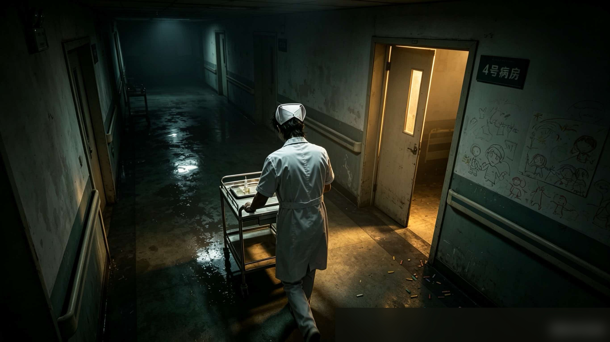

# 2.2 监控里的黑影 — 案件 02 · 阶段 A

网页悬疑解密游戏 · 单机关卡 · 可独立打开运行

## 目录结构

```
2.2监控里的黑影/
├── index.html          # 主文件（双击即可在浏览器打开）
├── assets/
│   └── corridor.jpg    # 监控画面背景图
└── README.md
```

## 怎么打开

- **Windows**：双击 `index.html`，用任意现代浏览器（Edge / Chrome / Firefox）打开即可。
- **发给同事**：把整个 `2.2监控里的黑影/` 目录打 zip 发出去即可，**不需要安装任何依赖**。
- 全程离线运行，不联网，不调用任何外部资源。

## 怎么玩

1. 顶部条会显示 **5 个未点亮的菱形碎片**，代表 5 处可疑细节。
2. 在走廊画面里找到 5 个可点击的圆形热区（鼠标悬停时显示标签 ① 帽沿 / ② 肩线 / ③ 托盘 / ④ 握姿 / ⑤ 水迹）。
3. 依次点击，每次弹出一段 **林深笔记**（点击的细节即被点亮）。
4. 5 处全部点完后，自动弹出 **推断总结**，玩家可点击"进入审讯阶段"继续下一关。

> 备注：本关是**单步关卡**（找到所有线索 → 触发推断），不设计错误反馈。所有点击均为有效动作。

## 文案位置（便于叙事组替换）

5 段笔记的文案全部在 `index.html` 的 `<script>` 块顶部的 `notes` 对象里：

```js
const notes = {
  cap:        { title: "...", body: ["...", "...", "..."] },
  shoulder:   { ... },
  tray:       { ... },
  handle:     { ... },
  footprint:  { ... }
};
```

每段 = 标题 + 2~3 句**斜体短句**。直接修改即可，刷新页面生效。

> 写作原则（来自《游戏框架 2.0》第 8 节）：
> - **克制**：每段 2~3 句话，不超过 3 句。
> - **不解释剧情**：只写角色（林深）的观察与情感反应。
> - **不安慰、不煽情**：用细节代替形容词。

## 热区坐标调整

5 个热区定位在 `index.html` 的 `.hotspot` div 上，使用 **百分比定位**（相对图片本身）：

```html
<div class="hotspot" data-id="shoulder"
     style="top: 39.53%; left: 39.26%; width: 12%; height: 10%;"></div>
```

如果美术换图后位置不对，直接调整这 5 个 div 的 `top / left / width / height` 即可。
也可以用同目录的 `标定工具.html` 重新标定坐标。

| 序号 | ID | 名称 | 位置 (top, left, w, h) |
|---|---|---|---|
| ① | `shoulder` | 肩线 | 39.53%, 39.26%, 12%, 10% |
| ② | `tray` | 托盘 | 49.74%, 34.44%, 12%, 10% |
| ③ | `footprint` | 脚步 | 88.35%, 42.36%, 16%, 10% |
| ④ | `handle` | 握姿 | 56.39%, 36.17%, 10%, 10% |
| ⑤ | `cap` | 帽沿 | 27.70%, 41.81%, 8%, 9% |

## 美术资源替换

把任意 `.jpg / .png` 图片放到 `assets/corridor.jpg`（同名覆盖）即可，或修改 `index.html` 里：

```html

```

为新路径。建议图片宽高比 **2732 : 1534 ≈ 16:9**，否则热区位置会偏。

## 浏览器兼容性

- ✅ Chrome / Edge 90+
- ✅ Firefox 88+
- ✅ Safari 14+
- 不依赖任何 JS 框架 / 第三方库。

## 与全游戏的衔接

完成本关（D-06 / D-07 / D-08 三项）后，应衔接 **案件 02 · 阶段 B · 审讯赵医生**（工作清单 2.3）。
本关末尾的"进入审讯阶段"按钮目前只是关闭弹窗，没有跳转——待后续接入主场景管理器。